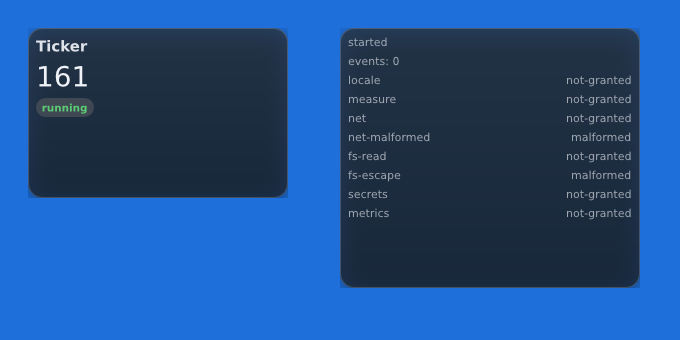

<div align="center">

<picture>
  <source media="(prefers-color-scheme: dark)" srcset="assets/wordmark-dark.svg">
  
</picture>

### Desktop widgets that cost nothing when nothing happens.

One GPU-rendered host, many sandboxed WASM widgets — composited per pixel
against your wallpaper, below your windows.

[](https://github.com/JosunLP/uniwidged/actions/workflows/ci.yml)
[](https://josunlp.github.io/uniwidged/)
[](https://github.com/JosunLP/uniwidged/releases)
[](https://josunlp.github.io/uniwidged/reference/abi)
[](#licence)

[**Documentation**](https://josunlp.github.io/uniwidged/) ·
[Quick start](https://josunlp.github.io/uniwidged/guide/quick-start) ·
[Write a widget](https://josunlp.github.io/uniwidged/guide/writing-a-widget) ·
[API](https://josunlp.github.io/uniwidged/reference/api) ·
[Changelog](CHANGELOG.md)

</div>

---



<sub>Not a mock-up: `uniwidged run` on an X11 session. Two WASM components, each
in its own desktop-layer window with its own swapchain, drawn from one GPU
device. The right-hand one is the conformance widget, reporting that every
capability it tried was refused.</sub>

## Why uniwidged

A desktop widget is on screen all day. That changes what matters.

- **🪶 Zero-cost idle.** No idle loop, no idle frame. Every widget says when it
  next wants to be called; the host sleeps until the earliest of those, and a
  view that did not change submits nothing to the GPU. Eight clocks cost one
  wake-up, not eight.
- **🧩 Sandboxed by default.** Widgets are `wasm32-wasip2` components with no
  ambient authority, a memory cap and a 16 ms deadline per call. They reach
  only what their manifest named — `net:api.open-meteo.com`, not "the network"
  — and you approved.
- **🎨 You describe, the host draws.** No colours, fonts or pixels in the API:
  roles and accents. Vello, Parley, taffy and AccessKit do layout, shaped text,
  Oklch colour and screen-reader support once, for everyone — so twenty
  authors look like one product, in every theme.
- **🔏 Signed, then trusted.** Ed25519 over the component **and** its
  manifest. Registries are one signed TOML file on a static host, and
  downloading is still not trusting.
- **🖥️ Wayland and X11.** A `wlr-layer-shell` surface on the bottom layer, or
  a 32-bit `_NET_WM_STATE_BELOW` window. Placement by monitor *name* that
  survives docking and unplugging.
- **🧪 Measured, not asserted.** 21 golden images on a software Vulkan device,
  a sandbox conformance suite, and real compositors, X servers and TLS servers
  in CI.

## Quick start

```sh
# Debian/Ubuntu: the .deb from the latest release — or build from source:
sudo apt install pkg-config libfontconfig1-dev libxcb1-dev
cargo install --locked --git https://github.com/JosunLP/uniwidged --tag v1.0.0 uniwidged-cli

uniwidged doctor              # what this session can do
uniwidged run                 # start the desktop
uniwidged autostart enable    # …and with every session from now on
```

Full instructions, including Arch and shell completions:
[**Installation**](https://josunlp.github.io/uniwidged/guide/installation).

## A whole widget

```sh
rustup target add wasm32-wasip2
uniwidged new clock && cd clock
cargo build --release --target wasm32-wasip2
uniwidged install target/wasm32-wasip2/release/clock.wasm --allow-unsigned
```

```rust
use uniwidged_guest::prelude::*;

#[derive(Default)]
pub struct Clock;

impl Widget for Clock {
    fn view(&mut self, cx: &Cx) -> View {
        let now = now_seconds();
        // A refusal is shown, not hidden.
        let time = cx.format_time(now).unwrap_or_else(|_| "--:--".into());
        let date = cx.format_date(now).unwrap_or_default();

        panel(NodeId::named("clock"))
            .align(Align::Center)
            .child(text(time).role(Role::Display))
            .child(text(date).role(Role::Caption).muted())
            .view()
    }

    // The top of the next minute — not "in 60 seconds" — so it stays right
    // across a suspend, a time-zone change and an NTP step.
    fn wake(&self) -> Wake {
        Wake::at_next_multiple_of(60, now_seconds())
    }
}

uniwidged_guest::export!(Clock);
```

```toml
# widget.toml — everything a user is asked to approve
name = "clock"
version = "1.0.0"
description = "The time and the date, in your locale"
capabilities = ["timer", "locale"]
memory-mb = 8
```

Off-target the whole thing still compiles and its tests still run, so a
widget's logic can be tested without a WASM toolchain. The
[**authoring guide**](https://josunlp.github.io/uniwidged/guide/writing-a-widget)
is the rest; [`widgets/`](widgets) holds eight reference widgets covering
`timer`, `locale`, `metrics`, `fs`, `command` and `secrets`. There is no worked
example for `net`, `link` or `measure` yet — the guide and the API reference
cover them.

## Capabilities

| Capability | Grants |
|---|---|
| `timer` | being woken on a schedule |
| `locale` | dates and times in the user's locale |
| `measure` | measuring text with the host's real fonts |
| `metrics` | CPU, memory, disk, battery and network counters |
| `fs:<subpath>` | one folder inside the widget's own directory |
| `net:<host>` | HTTPS to exactly that host — redirects off it refused |
| `link:<host>` | opening that host in the browser, at the user's click |
| `secrets` | an encrypted keychain namespaced to the widget |
| `command:<name>` | one declared program — no shell, no stdin, bounded |

Every host call returns a `Result`, and the refusals are distinguished:
`NotGranted`, `Unavailable` and `Malformed` are fixed by three different
people. [More →](https://josunlp.github.io/uniwidged/guide/capabilities)

## Day to day

```sh
uniwidged status                              # what is on the screen right now
uniwidged list                                # what is installed, granted what
uniwidged log -f                              # what the desktop is saying
uniwidged configure system-load --set warn-at=0.8
uniwidged move clock --x 48 --y 48 --output DP-1
uniwidged registry add https://widgets.example/index.toml --key 3d40…
uniwidged search clock && uniwidged add clock
uniwidged help <command>
```

Every command that changes the configuration reaches a running desktop at once
— widgets appear, move, reconfigure and upgrade without a restart.
[CLI reference →](https://josunlp.github.io/uniwidged/reference/cli)

## Stability

**1.0 freezes the widget interface.** A widget built against uniwidged 1.0 —
widget ABI 9 — runs on every 1.x release. The interface may grow; it does not
shrink or change before 2.0, and a widget that needs a newer host is refused
in a sentence that says so.
[ABI & stability →](https://josunlp.github.io/uniwidged/reference/abi)

## Platforms

| | Status |
|---|---|
| Linux · Wayland (`wlr-layer-shell`: sway, Hyprland, KDE, river, labwc, …) | ✅ supported |
| Linux · X11 with a compositing manager | ✅ supported |
| Linux · GNOME Wayland (no layer shell) | ⚠️ runs as ordinary windows |
| Windows | 🛣️ 1.x — milestone M5 |
| macOS | 🛣️ 1.x — milestone M6 |

## Documentation

| | |
|---|---|
| [**Guide**](https://josunlp.github.io/uniwidged/guide/introduction) | introduction, installation, quick start, core concepts, troubleshooting |
| [**Writing a widget**](https://josunlp.github.io/uniwidged/guide/writing-a-widget) | the authoring guide, from scaffold to publishing |
| [**API reference**](https://josunlp.github.io/uniwidged/reference/api) | every function, type, limit and refusal on one page |
| [**Security model**](https://josunlp.github.io/uniwidged/project/security) | what is promised, and what deliberately is not |
| [`ARCHITECTURE.md`](ARCHITECTURE.md) | the design document the code is written against |
| [`ROADMAP.md`](ROADMAP.md) | every milestone, how it was measured, what comes next |

The site is built from [`docs/`](docs) with VitePress:
`cd docs && npm install && npm run dev`.

## Layout

```
crates/
  uniwidged-core       geometry · colour · ids · events · the wake model
  uniwidged-view       the view tree that crosses the sandbox boundary
  uniwidged-compose    view → layout → text → Vello scene · hit rects · a11y
  uniwidged-render     one wgpu device, many surfaces, swapchain or readback
  uniwidged-shell      desktop-layer surfaces: wayland · x11 (win32 · appkit planned)
  uniwidged-runtime    the WASM sandbox: capabilities, limits, signatures, registries
  uniwidged-guest      the SDK widget authors compile against
  uniwidged-host       the daemon: scheduler, configuration, supervision
  uniwidged-cli        `uniwidged run · status · log · new · install · …`
wit/uniwidged.wit      the host/guest contract — frozen for 1.x
widgets/               eight reference widgets, and the test fixtures beside them
docs/                  the documentation site (VitePress)
assets/                the logo and brand assets
packaging/             a .deb that CI builds and inspects, a PKGBUILD, the man page
spikes/                the M0 and M4 proofs that the whole thing is possible
```

## Building from source

```sh
cargo test --workspace
```

Every dependency is on crates.io; there is no sibling checkout to arrange.
Some suites need more than a compiler, and say so rather than skipping quietly:

| Suite | Needs | Without it |
|---|---|---|
| golden images, live desktop | a Vulkan driver (`mesa-vulkan-drivers` for lavapipe) | skips; `UNIWIDGED_REQUIRE_GPU=1` fails |
| sandbox conformance | `rustup target add wasm32-wasip2` | — it builds its own widget |
| layer shell | `sway` (starts its own headless compositor) | skips; `UNIWIDGED_REQUIRE_WAYLAND=1` fails |
| pointer, two monitors, hotplug | `Xvfb`, `xrandr` | skips; `UNIWIDGED_REQUIRE_X11=1` fails |
| HTTPS, registries | `openssl` (starts its own TLS server; no internet) | skips; `UNIWIDGED_REQUIRE_NET=1` fails |

CI sets every `UNIWIDGED_REQUIRE_*`, so a green run is never a run that proved
nothing. See [`CONTRIBUTING.md`](CONTRIBUTING.md).

## Where it comes from

uniwidged is the union of two projects.
[**Ephemeris**](https://github.com/JosunLP/Ephemeris) worked out how a window
becomes a *desktop widget* on every platform — that is `uniwidged-shell`.
[**Ferrum UI**](https://github.com/j-pfalzgraf/ferrumui) is a GPU-rendered UI
stack on Vello, wgpu, Parley, taffy and AccessKit — that is where the rendering
techniques come from. Both are adopted, not depended on; [`NOTICE.md`](NOTICE.md)
records what came from where. What is new is the seam between them, and the
sandbox boundary that lets somebody else write a widget.

## Contributing

Bug reports, widgets and pull requests are welcome — see
[`CONTRIBUTING.md`](CONTRIBUTING.md). Security problems go through
[private reporting](https://github.com/JosunLP/uniwidged/security/advisories/new),
see [`SECURITY.md`](SECURITY.md).

## Licence

MIT OR Apache-2.0, at your option — deliberately, because a framework's licence
is the licence its users inherit, and a widget author should be free to choose
their own. The shell layer derives from Ephemeris (GPL-3.0-or-later) under a
relicence by its sole copyright holder; the verification is in
[`NOTICE.md`](NOTICE.md).
