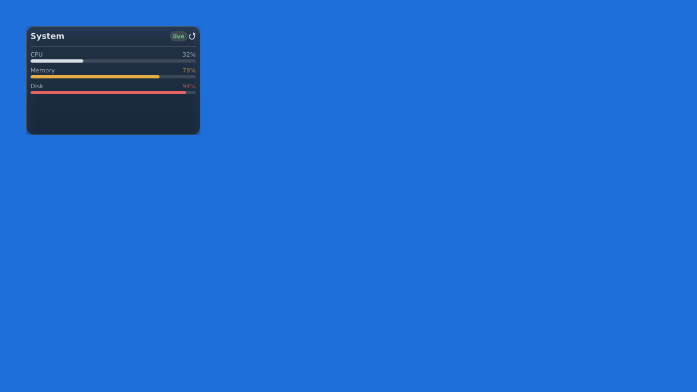
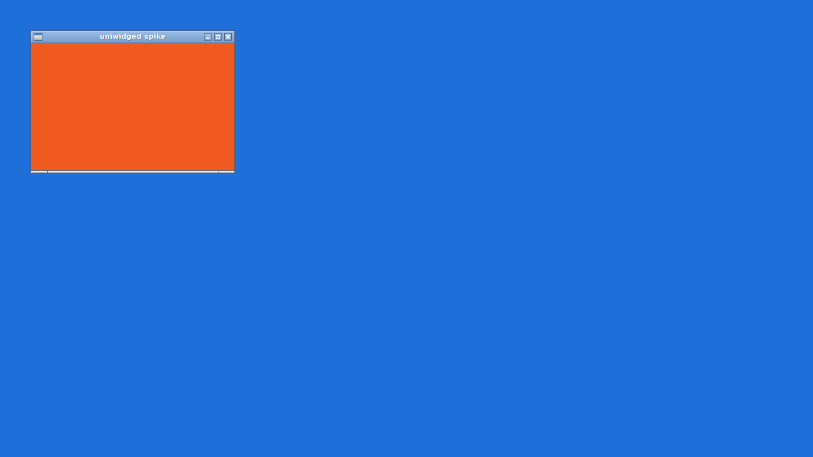

# M4 — Findings

Run on 2026-08-27. Xvfb 1280×720 (depth 24, Composite + RENDER), openbox 3.6,
xcompmgr, Mesa lavapipe (LLVM 20.1.2), wgpu 29.0.4, Vello 0.9.0.



`ARCHITECTURE.md` §10.1 named X11 as the project's highest technical risk. **On
this session the best of the three paths works** — but the caveat in §3 below
matters, and is the reason the fallback was built anyway.

## §10.1 — per-pixel alpha with a GPU swapchain on X11

```
32-bit TrueColor visual: 0x40
compositing manager: present
adapter: llvmpipe (LLVM 20.1.2, 256 bits) (Vulkan)
swapchain format: Some(Bgra8Unorm)
alpha mode: Some(PreMultiplied)
alpha path: GPU swapchain with pre-multiplied alpha
```

Verified by arithmetic, not by looking. The spike renders the same scene twice —
once to the window, once through readback — and `verify.py` composites the
headless image over two candidate backdrops:

| the headless scene composited over | mean | worst |
|---|---|---|
| the wallpaper | **0.59** | **1** |
| black | 30.88 | 203 |

One unit is 8-bit rounding. The two hypotheses separate cleanly, which is the
point of testing it this way: a single number cannot tell "transparent" from
"opaque over a dark scene", and the glass is dark enough that eyeballing it
cannot either.

## Stacking — the widget stays below ordinary windows



`_NET_WM_STATE_BELOW` is a request to the window manager, not a fact, so it is
checked the same way: screenshot the widget, open an opaque ordinary window over
the same place, screenshot again.

| sample | widget alone | window opened |
|---|---|---|
| title row | `rgb(33, 49, 68)` | `rgb(240, 90, 30)` |
| a meter | `rgb(29, 45, 64)` | `rgb(240, 90, 30)` |
| glass | `rgb(26, 41, 60)` | `rgb(240, 90, 30)` |

`_NET_WM_WINDOW_TYPE_UTILITY`, not `DESKTOP` — see the module note in
`uniwidged-shell`: `DESKTOP` means the window *is* the desktop, and window
managers that honour it stack the widget beneath the desktop icons and stop
delivering clicks.

## The caveat, and why the fallback exists anyway

**This is lavapipe.** Mesa's software Vulkan presents on X11 through
`XPutImage`/SHM, and that path can carry an alpha channel. A hardware driver
using DRI3/Present may well report `Opaque` and nothing else — which is exactly
what §10.1 predicted, and this run does not disprove it.

So the readback fallback is built and tested rather than left as a plan.
`SPIKE_FORCE_READBACK=1` takes it on a session where the swapchain path works,
which is the only way to keep it honest — a fallback nobody has run is a
fallback that has quietly stopped working. It produces the **same numbers**:

```
the same scene over the wallpaper: mean   0.59  worst   1
```

That is the claim in §10.1 measured rather than asserted: Vello rasterises on
the GPU either way, and only *presentation* falls back. The golden images
therefore still apply on a machine that takes this path.

One correction came out of building it. The plan said the fallback would
composite through XRender. It does not need to: the window already has a 32-bit
visual, so the compositor blends its contents exactly as it blends a
swapchain's. Putting premultiplied BGRA straight into the window with
`PutImage` is the whole of it — about forty lines.

**`EglArgb`, the second of the three paths, is not built.** It would give GPU
presentation on a driver that refuses alpha through Vulkan, where readback gives
GPU rasterisation and CPU presentation. That is a performance difference on
hardware nobody has measured yet, and building it now would mean maintaining an
EGL/GL path on a guess. `AlphaPath` still names it, so the decision is visible
rather than forgotten.

## Two bugs the screenshots found

Both were the same root cause — **taffy rounds a computed box down to whole
pixels** — and both were invisible to the golden-image suite, whose bundled font
made the arithmetic land differently.

* **"CPU" rendered as "C…"** with half the panel empty. A natural text width of
  26.7 became a box of 26, and the paint pass ellipsised text that fitted.
  Measured text is rounded up now. *(Found during M2, on the golden images.)*
* **"live" rendered as "li…"** in the chip. Ceiling the text was not enough: a
  chip's padding is a fraction of its font size, so a box of `20.96 + 2×5.72 =
  32.44` still rounded to 32 and the content rectangle came out 0.4 px short.
  The *whole box* is rounded up now, and a regression test sweeps five base font
  sizes against five labels so the arithmetic cannot land well by accident.

Chips and icons also no longer shrink: taffy shrank the chip when the row
overflowed, and a pill narrower than its text is not a pill. Text still shrinks,
because that is how it comes to be ellipsised.

## Reproducing

```sh
./run.sh                        # starts a nested X11 session if none is running
SPIKE_FORCE_READBACK=1 ./run.sh # the same, taking the fallback
```

The session needs three things that are easy to get wrong:

* **A compositing manager.** Without one the X server ignores a window's alpha
  channel and draws it opaque, whatever visual it has.
* **A root *pixmap*, not a root colour.** A compositor composites
  `_XROOTPMAP_ID`; `xsetroot -solid` does not set it, so the compositor paints
  grey and there is nothing to be transparent against. `hsetroot` does.
* **The compositor started *after* the wallpaper**, because it reads the root
  pixmap once — and **without `-c`**, or its own drop shadows darken the
  wallpaper behind the widget and the arithmetic compares against a backdrop it
  does not know. That cost an hour and two wrong conclusions.
